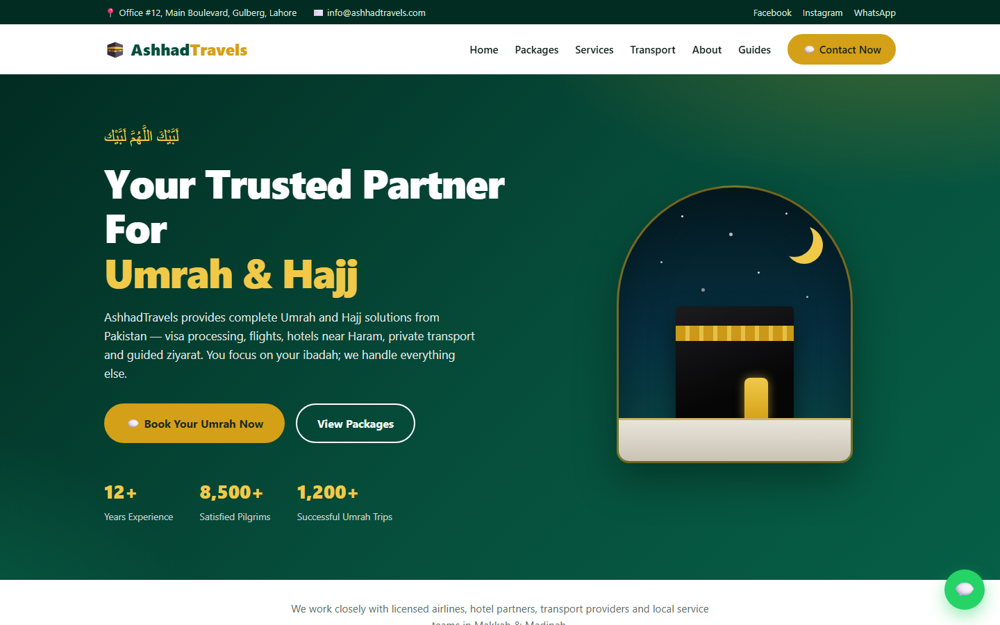
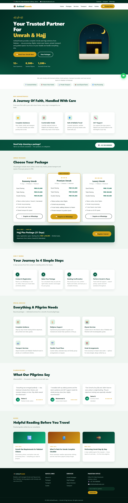
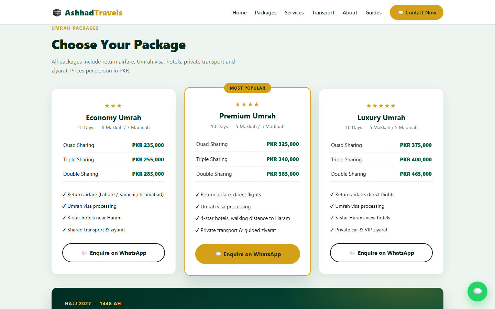
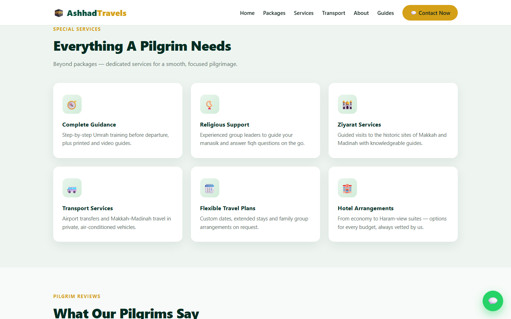
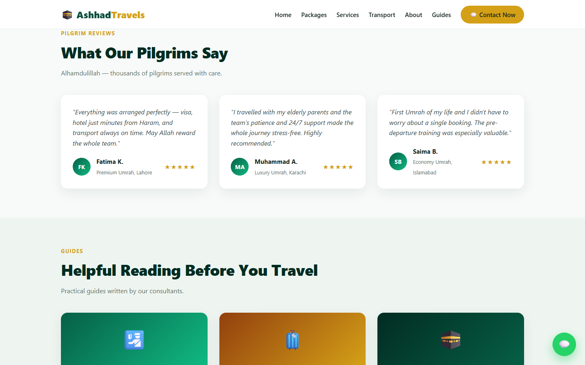
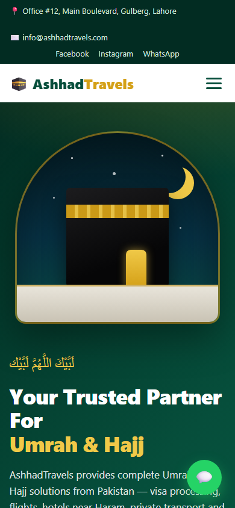
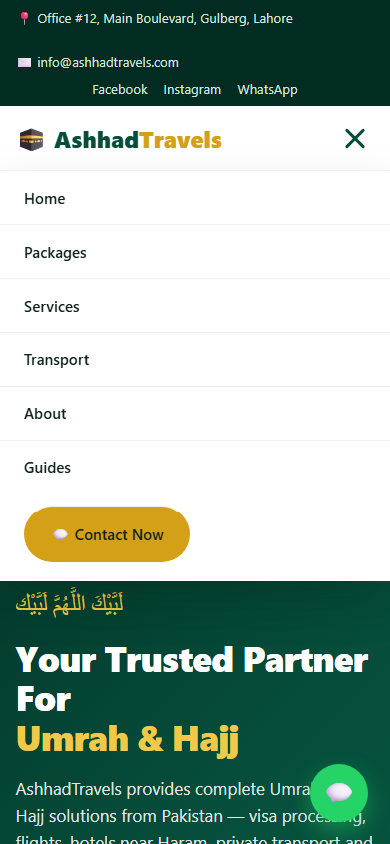

# AshhadTravels — Umrah & Hajj Landing Page

I built this as a single-page marketing site for an Umrah and Hajj travel agency based in Pakistan. The goal was a page a small agency could actually ship: packages with per-person prices and sharing options, the services pilgrims ask about (visa, hotels near the Haram, transport, ziyarat), a short "how it works", reviews, pre-travel guides, and WhatsApp as the one call to action everywhere, since that is how these agencies take bookings.

There is no framework, no build step and no JavaScript beyond a stubbed newsletter form. The page is one HTML file and one stylesheet; the hero's Kaaba illustration is drawn in pure CSS. A tiny Node script serves the folder locally. The agency details (office address, phone, email, prices, reviews) are placeholder content for the design.



## What it does

- **Top bar and navbar**: office address, email and social links, then a sticky navbar with anchor links to every section and a "Contact Now" button that opens WhatsApp. On phones the nav collapses into a hamburger menu implemented with the CSS checkbox trick, so it works with JavaScript disabled.
- **Hero**: the talbiyah in Arabic, headline, intro, two buttons (WhatsApp booking and "View Packages"), three trust numbers, and a CSS-only illustration of the Kaaba under a night sky with stars and a crescent.
- **Trust strip**: partner categories (airlines, hotels, transport, ziyarat teams, visa processing).
- **Why AshhadTravels**: four feature cards.
- **Support banner**: a phone number call-out for free package advice.
- **Packages**: three cards (Economy, Premium, Luxury) with star rating, duration and Makkah / Madinah split, a price table for quad / triple / double sharing, an inclusions list, and a WhatsApp link that pre-fills the package name in the message. The middle card is highlighted as "Most Popular". A Hajj banner below advertises the 21-day Hajj Plus package.
- **How it works**: four numbered steps from first contact to performing Umrah.
- **Special services**: six cards (guidance, religious support, ziyarat, transport, flexible plans, hotels).
- **Pilgrim reviews**: three testimonial cards with initials avatars and star ratings.
- **Guides**: three article cards with gradient covers.
- **Footer**: about blurb, quick links, services, office contact and a newsletter form (front-end only), plus a floating WhatsApp button fixed to the bottom-right of every view.

## How it works

- `index.html` holds all the content, sectioned with ids (`#home`, `#packages`, `#services`, `#transport`, `#about`, `#guides`, `#contact`) that the navbar links to.
- `style.css` defines the palette as CSS custom properties (deep greens and gold), the card, button, grid and section styles, the pure-CSS hero art (`.arch`, `.stars`, `.moon`, `.kaaba`, `.kiswah-band`, `.kaaba-door`, `.floor`), and three breakpoints at 960px, 720px and 480px that stack the grids and switch to the mobile menu.
- Every WhatsApp link is a `https://wa.me/<number>?text=...` deep link, so a tap on a phone opens a chat with the enquiry already typed.
- `server.js` is a dependency-free static file server built on Node's `http` and `fs` modules. It serves the folder on port 3000, maps `/` to `index.html`, sets content types by extension and refuses paths outside the folder.

## Stack

| Part | Choice |
|------|--------|
| Markup | Hand-written HTML5, semantic sections |
| Styling | Plain CSS with custom properties, grid and flexbox; CSS-only illustration and mobile menu |
| JavaScript | None (one inline `onsubmit="return false"` on the newsletter form) |
| Server | Node.js `http` module, no npm packages |

## Run it locally

```bash
git clone https://github.com/ashhhadd-210/travel-website.git
cd travel-website
node server.js
# open http://localhost:3000
```

The page also opens directly from disk (`index.html`) without the server. No credentials or environment variables are needed. To make the site live for a real agency, replace the placeholder phone number in the `wa.me` links, the address and email, and the package prices.

## Screenshots

Full page on desktop:



Package cards with sharing prices and WhatsApp enquiry buttons:



Special services grid:



Pilgrim reviews and guides:



Hero at phone width (390px):



Mobile menu open:



Full page at phone width:


